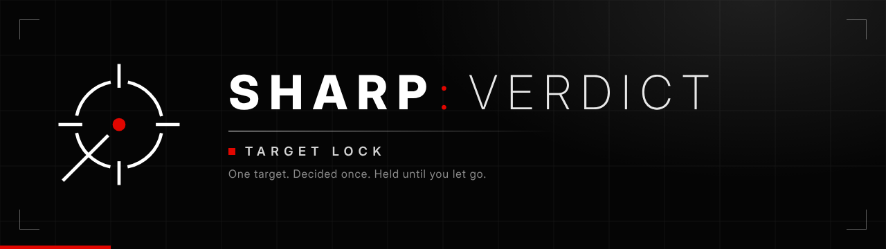
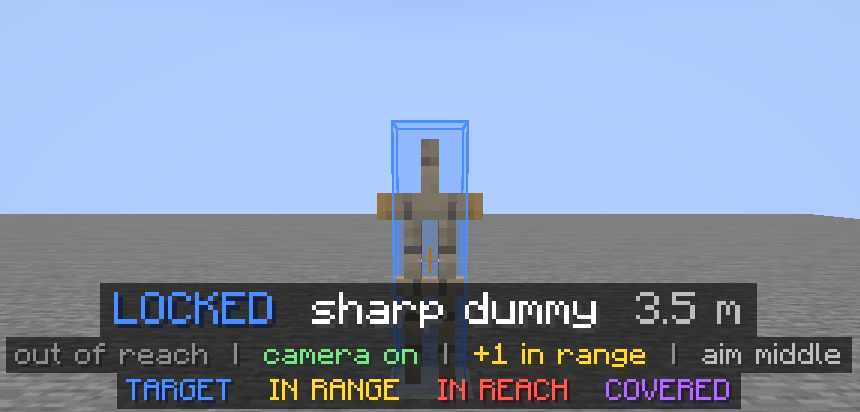
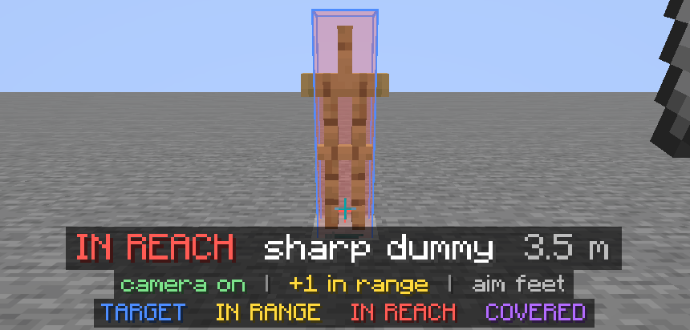
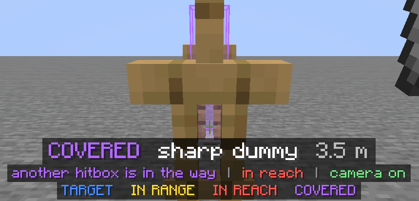

<p align="center">
  
</p>

<h3 align="center">One target. Decided once. Held until you let go.</h3>

<p align="center">
  <a href="https://github.com/VictorDeglon/sharp-verdict/releases/latest"></a>
  
  
  <a href="https://github.com/VictorDeglon/sharp-verdict/actions/workflows/build.yml"></a>
  <a href="docs/TESTING.md"></a>
</p>

<p align="center">
  <a href="https://github.com/VictorDeglon/sharp-verdict/releases/latest"><b>Download</b></a> &nbsp;&middot;&nbsp;
  <a href="#install">Install</a> &nbsp;&middot;&nbsp;
  <a href="#controls">Controls</a> &nbsp;&middot;&nbsp;
  <a href="#your-first-lock">First lock</a> &nbsp;&middot;&nbsp;
  <a href="#how-it-decides">How it decides</a> &nbsp;&middot;&nbsp;
  <a href="#settings-worth-knowing">Settings</a> &nbsp;&middot;&nbsp;
  <a href="#servers">Servers</a> &nbsp;&middot;&nbsp;
  <a href="#build-from-source">Build</a> &nbsp;&middot;&nbsp;
  <a href="#reference">Reference</a>
</p>

---

**SHARP: Verdict** is the target lock module of the **SHARP** client.

Hold one key. It picks the best target in range, outlines its real hitbox in colours that tell you what you can hit, and can glide your camera onto it. It never second-guesses itself: the target it takes is the target you keep, until you let go.

| | |
| --- | --- |
| **Pick** | Players first, then armor stands, then animals. Nearest wins inside a tier, and a handicap in blocks keeps a close sheep from beating a player who is almost as close. |
| **Hold** | One target for the whole press. It never jumps to another one, even a better one. |
| **Aim** | The middle of the body while the target is out of reach, the feet once it is in reach, and a smooth slide down while it falls. |
| **Skip** | End crystals, item frames, paintings, vehicles, projectiles, villagers, golems, your own pets, and anything else on an editable list. |
| **Show** | The real hitbox, coloured by what you can hit, and one line of status above the hotbar. |
| **Work** | Single-player, LAN and servers. Client side only. |

<table>
  <tr>
    <td width="33%"></td>
    <td width="33%"></td>
    <td width="33%"></td>
  </tr>
  <tr>
    <td align="center"><sub><b>LOCKED</b>. Bare hands do not reach 3.5 m.</sub></td>
    <td align="center"><sub><b>IN REACH</b>. An iron spear does, from the same spot.</sub></td>
    <td align="center"><sub><b>COVERED</b>. Another hitbox is in the way.</sub></td>
  </tr>
</table>

<p align="center"><sub>Taken by the real-game test in Minecraft 26.3. Nothing is staged: these are the frames it checks.</sub></p>

> [!NOTE]
> **Honest status.** 314 unit tests pass, and the real-game test passed for 0.4.0: 78 checks in Minecraft 26.3 on macOS, run on 2026-10-26. Nothing has run on a real multiplayer server yet. Details in [docs/TESTING.md](docs/TESTING.md).

## Install

1. **Fabric Loader 0.19.5 or newer** for Minecraft **26.3**, from [fabricmc.net/use](https://fabricmc.net/use/installer/). The official launcher brings the right Java. If you use another launcher, pick **Java 25**.
2. **Fabric API 0.163.0+26.3**, into your `mods` folder.
3. **`sharp-verdict-0.4.0.jar`** from the [Releases](https://github.com/VictorDeglon/sharp-verdict/releases) page, into the same `mods` folder.
4. Start the game, open a world or join a server, and **hold `G`**.

Coming from an older SHARP jar? Delete it first. The mod id is still `sharp`, so your config and keybinds carry over.

## Controls

| Key (default) | Action |
| --- | --- |
| `G` (hold) | Lock the best target. Active only while held. Release and press again to pick a new one. |
| `H` | Camera tracking on or off. It starts **off**. |
| `J` | Debug panel. |
| `K` | Status text: auto, minimal, off. |

All four are under **Controls > SHARP: Verdict** and can be rebound there.

## Your first lock

You do not need a server or a second player. In a creative world:

```
/summon minecraft:armor_stand ~ ~ ~5 {NoGravity:1b}
/summon minecraft:sheep ~3 ~ ~4
```

1. Face roughly toward them and **hold `G`**. The armor stand is outlined in **blue**, the sheep in **yellow**. The text above the hotbar says `LOCKED`.
2. Press **`H`** to turn camera tracking on, then hold `G` again. Your view glides onto the target and stops.
3. Walk close enough to hit it. The outline picks up **red**, and the aim point drops from the middle of the body to the feet.
4. Kill the armor stand while still holding `G`. The lock goes quiet instead of jumping to the sheep. Release and press again to lock the sheep.
5. Press **`J`** to see exactly why it chose what it chose.

## What you see

| Colour | Meaning |
| --- | --- |
| **Blue** | The target the lock is on. Thicker while the camera is following it. |
| **Yellow** | Another target in range. |
| **Red** | The weapon in your main hand can hit it from where you stand. On the main target the outline stays blue and its fill and aim cross turn red. |
| **Purple** | The target is covered by another hitbox, or you are standing inside it. |
| **Cyan** | The aim cross, when the target holds a shield up. |

Reach is not a number the mod guesses. It asks the game whether the item in your hand could hit that box from where you stand, so a spear, a sword and bare hands each give their own answer.

## How it decides

Every candidate gets a rank in blocks. Lowest wins.

```
rank = distance + handicap(kind) + 0.1 * (degrees away from your crosshair)
```

| Kind | Handicap | Setting |
| --- | --- | --- |
| Players, mannequins, fake-player bodies | 0 | |
| Armor stands | 3 blocks | `armorStandPenalty` |
| Animals and everything else that lives | 6 blocks | `otherPenalty` |

So a player beats an animal unless the animal is more than 6 blocks closer. A sheep 2 blocks away loses to a player 2.5 blocks away, and beats a player 15 blocks away. Between two of the same kind the nearer one wins, and the crosshair only breaks near-ties (30 degrees off costs 3 blocks).

Range, field of view and line of sight decide who is eligible at all, before any of this: a player behind you never beats a sheep in front of you when the cone is 140 degrees. Set `priorityTiers` to `false` for the earlier behaviour: the entity closest to the crosshair wins and distance only breaks ties.

**Aim height** follows the situation. Out of reach: the middle of the body, the biggest and most forgiving spot. In reach: the feet zone, within about a tenth of a second. Falling: the middle while the target is 5 or more blocks above your feet, sliding down as it comes level with you. Nothing is random, and nothing moves faster than the camera's own limits.

## Settings worth knowing

Everything lives in `config/sharp.json`, created on first launch and re-read each time you join a world. The full table is in the reference below.

| Setting | Default | What it does |
| --- | --- | --- |
| `range` | `64` | How far it will lock, in blocks. |
| `fovDegrees` | `140` | Width of the cone in front of you it looks in. |
| `cameraTrackingEnabled` | `false` | Camera follows the target. Same as pressing `H`. |
| `cameraSensitivity` / `cameraSmoothing` | `2.0` / `0.2` | How fast and how softly the camera closes in. |
| `armorStandPenalty` / `otherPenalty` | `3` / `6` | How strongly players are preferred. `0` / `0` ranks by distance alone. |
| `priorityTiers` | `true` | Off: the entity nearest your crosshair wins instead. |
| `ignoredEntityTypes` | see reference | Types that are never targeted. `*` wildcards work. |
| `requireMarker` | `false` | On: only entities named `sharp...` or in a team called `sharp`. |
| `aimAdaptive` | `true` | Off: always the feet-first order. |
| `statusStyle` | `auto` | `auto`, `full`, `minimal` or `off`. |

## Servers

It runs on any server and the camera follows the target there too. Other players' positions arrive over the network, so the lock follows where your client last heard they were, slightly behind where they really are.

A lock-on that turns your camera onto other players is aim assist. **Most public servers prohibit it and many detect it.** The mod does not hide itself in any way. Use it where it is allowed: your own server, a friend's, a practice server.

## Build from source

You need **JDK 25** and an internet connection. The first build downloads Minecraft and the mappings.

```bash
./gradlew build                 # compile, run the 314 unit tests, produce build/libs/sharp-verdict-0.4.0.jar
./gradlew test                  # unit tests only, fast
./gradlew runClient             # a development client with the mod loaded
./gradlew runClientGameTest     # plays the feature in the real game (needs OpenGL; on Linux: xvfb-run -a ./gradlew runClientGameTest)
```

The mod is `build/libs/sharp-verdict-0.4.0.jar`. Ignore `sharp-verdict-0.4.0-sources.jar`.

On macOS with Homebrew, `brew install openjdk@25` and point `JAVA_HOME` at it for the build: `export JAVA_HOME=$(brew --prefix openjdk@25)/libexec/openjdk.jdk/Contents/Home`.

Releases are built by GitHub Actions. Push a tag `vX.Y.Z` that matches `mod_version` and has a section in [CHANGELOG.md](CHANGELOG.md), and the release workflow attaches the jar, the unit test results, and those notes.

## Reference

Everything below is the long form. Open what you need.

<details>
<summary><b>Where it aims, shields, and standing inside the target</b></summary>

The height it prefers depends on what the target is doing. Heights are fractions of the box's *current* height (0 feet, 1 top), so the spot stays inside the box when it shrinks (elytra, swimming, crawling).

| Situation | Preferred spot |
| --- | --- |
| **Out of reach** of the weapon you hold | The **middle** (0.5). It is the biggest, most forgiving spot and moves least when the target turns or crouches, so it is the easiest to stay on while you close in. |
| **In reach** | The **feet zone** (0.12 of the box, just above the bottom edge so a little tracking error still lands inside). Then `aimHeight` (0.3), then the middle, then the upper body. |
| **Falling** (dropping faster than 2.5 blocks per second) | The **middle** while it is 5 or more blocks above your feet, sliding down toward the spot above as it comes level with you. It will land where you are, so the point is already there when it does. Out of reach and falling stays on the middle. |

Changes between those are never sudden. The preferred height moves at most 2.5 box heights per second, so coming into reach takes about a tenth of a second and the camera never lurches. Going back to the middle is slower on purpose: the target has to stay out of reach for a quarter of a second first, so standing on the edge of reach does not make the aim point flicker.

The preference is only a first choice. A spot is skipped when a block hides it, or when another entity's hitbox would be hit first. Spots to the left and right are tried too, so a target half hidden behind another one is aimed at where it sticks out. Turn the whole behaviour off with `aimAdaptive` and it always uses the feet-first order.

There is **no randomness** anywhere in the aim: no jitter in the point, the speed or the timing. The same inputs always give the same camera. The camera's smoothness comes from its easing, its speed and acceleration limits and its fade-in, which is what makes it feel natural without adding noise that would only make it less accurate.

#### Shields
With a shield raised, the aim point moves to the **back** of the target. Read this part carefully:

Vanilla decides whether a shield blocks your hit from **where you stand**, not from where you aim. So aiming at the back does nothing for your damage by itself. What matters is that you are on the back half of the shielder. That is why the status row says either *shield blocks you, get behind it* or *shield up, you are behind it*. The camera follows the back point, the text tells you what you need to do with your feet.

#### Standing inside the target
If your eye is inside the target's box, it is shown purple, locks regardless of where you look, and the camera **holds still** (aiming at a point a hand's width away would whip the view around).

</details>

<details>
<summary><b>What happens when you hold it, and when it switches itself off</b></summary>

- **Selection.** Among the entities inside `range` and the `fovDegrees` cone (64 blocks and 140 degrees by default), it picks the best one by the rules in [How it decides](#how-it-decides). Entities behind blocks are skipped (`requireLineOfSight`).
- **It does not change its mind.** The first target it takes is the target for the whole hold. If that target dies, leaves range or the cone, or is hidden behind a block, the lock goes quiet (`NO TARGET`) and waits. It never moves to another entity, even a better one, and it picks the same one up again if it becomes valid. To lock something else, let go of the key and press it again. If nothing was valid when you pressed, the first valid target during that hold is the one it takes.
- **Camera (optional, off until you press `H`).** It eases your view onto the target: fast, never overshooting, with a speed limit, an acceleration limit and a per-frame limit. It backs off when you move the mouse yourself. In the real game it closes a 27 degree gap in 8 ticks (0.4 s).
- **Release.** Let go and the lock, outline and camera motion all stop on that same frame.

#### When it switches itself off
It turns off at once, clears the target, and **will not turn back on while you keep holding the key**. You have to release and press again. That applies to:

- releasing the key
- the window losing focus (alt-tab)
- any screen opening (inventory, chat, pause)
- dying or respawning
- changing world or dimension
- disconnecting, or leaving the world

</details>

<details>
<summary><b>Who can be targeted, and the ignore list</b></summary>

A living entity can be targeted when all of these hold:

1. `enabled` is true in the config.
2. It is within `range` and inside the `fovDegrees` cone, and (with `requireLineOfSight`) not hidden behind blocks.
3. It is not you, not dead or dying, and not a spectator.
4. The game's own crosshair could pick it (an armor stand with the marker flag cannot be hit, so it is skipped).
5. Its type is not on the ignore list (below), and it is not one of your own tamed pets (`ignoreOwnPets`).
6. If `requireMarker` is on: its name starts with the marker, or its team is named exactly that.

### The ignore list

Only living entities are ever candidates, so end crystals, item frames, paintings, boats, minecarts, projectiles, items and the like could never be locked in the first place. They are on the list anyway so the intent is written down. Decorated pots and flower pots are blocks, not entities, so they are never candidates either.

`ignoredEntityTypes` in the config, with these defaults. A missing namespace means `minecraft`, `*` matches anything, and an empty list ignores nothing.

| Group | Types |
| --- | --- |
| Explodes, breaks or is decoration | `end_crystal`, `item_frame`, `glow_item_frame`, `painting`, `leash_knot`, `tnt` |
| Vehicles | `*boat`, `*raft`, `*minecart` |
| Loose items and effects | `item`, `experience_orb`, `falling_block`, `area_effect_cloud`, `lightning_bolt`, `marker`, `interaction`, `*_display` |
| Thrown and fired | `*potion` (splash and lingering), `*arrow`, `trident`, `snowball`, `egg`, `ender_pearl`, `eye_of_ender`, `experience_bottle`, `firework_rocket`, `fishing_bobber`, `*fireball`, `wither_skull`, `shulker_bullet`, `llama_spit`, `*wind_charge` |
| Living, but not something to hit | `villager`, `wandering_trader`, `iron_golem`, `snow_golem`, `copper_golem`, `allay`, `happy_ghast` |

Armor stands are **not** on it: they are the second tier. These still count as targets: players, mannequins, armor stands, animals, hostile mobs, `zombie_villager`, `ender_dragon`.

</details>

<details>
<summary><b>The text above the hotbar</b></summary>

While the key is held, a short coloured status shows in the lower middle of the screen, in the same colours as the outlines. It does not stay loud: by default it is **full for the first 3 seconds of each hold, then shrinks to one dim line** with no backing strip.

```
first 3 seconds                                  after that (one dim line)

LOCKED  sharp dummy  13.1 m                      LOCKED  13.1 m
out of reach | camera off | +1 in range | aim feet
TARGET   IN RANGE   IN REACH   COVERED
```

The state word is the part that matters, and it is coloured:

| Word | Colour | Meaning |
| --- | --- | --- |
| `LOCKED` | blue | Locked, the held weapon cannot reach it yet. |
| `IN REACH` | red | The held weapon can hit it. |
| `COVERED` / `INSIDE` | purple | Another hitbox is in the way, or you are inside it. |
| `SHIELD UP` | cyan | It holds a shield up. |
| `NO TARGET` / `SHARP OFF` | orange | Nothing to lock, or it cannot run here. The full version says what is missing or why. |

Four styles, set with `statusStyle` or by pressing `K` in game (the key cycles auto, minimal, off):

| Style | What you get |
| --- | --- |
| `auto` (default) | Full text for `statusFullSeconds` (3) after the key goes down, then one dim line. |
| `minimal` | The one dim line, always. |
| `full` | The full text for as long as you hold the key. Only reachable from the config. |
| `off` | No text at all. The outlines and colours are untouched. With the text off, a closed gate or an empty lock is silent, so press `J` and read the `gate:` and `target:` lines if holding the key seems to do nothing. |

</details>

<details>
<summary><b>Full configuration table</b></summary>

`config/sharp.json` in your game folder, created on first launch. It is re-read each time you join a world. Bad values are clamped into range. A file that is not valid JSON is kept as `sharp.json.broken` and replaced with defaults.

**Upgrading from the first release:** its file is detected, copied to `sharp.json.v1.bak`, and replaced with the new defaults. Only your on/off switches, the practice marker, camera tracking and the debug flags are carried over, and `requireMarker` is switched on so it keeps targeting only marked entities. A file from 0.2.0 has no `requireMarker` key, so it gets the new default (off) and every entity is a target. Old tuning values were just the old defaults written to disk, and keeping them would hide every improvement. The log says when this happens.

| Key | Default | Range | What it does |
| --- | --- | --- | --- |
| `enabled` | `true` | | Master switch. |
| `requireMarker` | `false` | | Only entities carrying the marker can be targeted. Off: every living entity counts. |
| `practiceMarker` | `"sharp"` | up to 32 chars | Name prefix or team name the marker is. Only used with `requireMarker`. |
| `range` | `64.0` | 1 to 128 | Max distance in blocks, measured to the hitbox surface. |
| `fovDegrees` | `140.0` | 1 to 360 | Full cone around the crosshair. 140 means 70 degrees each side. 360 turns the limit off. |
| `aimHeight` | `0.3` | 0 to 1 | Aim spot when the feet are not wanted or not visible: 0 feet, 0.5 centre, 1 top. Fraction of the current box height. |
| `aimFeetFirst` | `true` | | Try the feet first. |
| `aimShieldRear` | `true` | | Aim at the back of a target with a shield up. |
| `aimAvoidCover` | `true` | | Aim at a part that another hitbox does not cover. |
| `ignoredEntityTypes` | the list above | up to 256 entries | Entity types that are never targeted. |
| `ignoreOwnPets` | `true` | | Never target a tamed wolf, cat or parrot that is yours. |
| `aimAdaptive` | `true` | | Middle of the body out of reach, feet in reach, slide down while falling. Off: always the feet-first order. |
| `priorityTiers` | `true` | | Rank by distance with a handicap per kind (players, then armor stands, then the rest). Off: the crosshair decides. |
| `armorStandPenalty` | `3.0` | 0 to 64 | Blocks added to an armor stand's distance when ranking. |
| `otherPenalty` | `6.0` | 0 to 64 | The same for animals and every other entity. Never below `armorStandPenalty`. |
| `distanceWeight` | `0.05` | 0 to 5 | Only with `priorityTiers` off: degrees of penalty per block of distance. Higher favours near targets. |
| `retainMarginPercent` | `0.0` | 0 to 50 | Extra slack for keeping a lock at the edge of range or cone. 0 is strict. |
| `requireLineOfSight` | `true` | | Skip targets behind blocks. |
| `cameraTrackingEnabled` | `false` | | Camera follows the target while the key is held. |
| `cameraSensitivity` | `2.0` | 0.1 to 5 | Higher closes the gap faster. |
| `cameraSmoothing` | `0.2` | 0 to 1 | 0 is snappiest, 1 is gentlest. |
| `maxRotationSpeed` | `540.0` | 10 to 1440 | Hard cap, degrees per second. |
| `maxRotationAcceleration` | `6000.0` | 50 to 20000 | Hard cap on how fast the speed can change, degrees per second squared. |
| `maxStepPerFrame` | `45.0` | 0.1 to 90 | Hard cap on rotation in one frame, degrees. |
| `deadzoneDegrees` | `0.1` | 0 to 5 | Camera holds still when this close. Stops jitter. |
| `rampSeconds` | `0.08` | 0 to 3 | Fade-in time when tracking starts. |
| `pitchMin` / `pitchMax` | `-85` / `85` | -90 to 90 | Pitch range the assist may aim at. Negative is up. |
| `yieldToManualInput` | `true` | | Back off while you move the mouse. |
| `yieldRate` | `120.0` | 10 to 2000 | Your turn speed (degrees per second) at which it has fully backed off. |
| `hitboxEnabled` | `true` | | Draw the outlines. |
| `hitboxRenderDistance` | `96.0` | 1 to 256 | Boxes farther than this from the camera are not drawn. |
| `hitboxFill` / `hitboxFillAlpha` | `true` / `0.12` | 0 to 1 | Faint fill inside the main outline. |
| `hitboxAimMarker` | `true` | | Cross at the aim point. |
| `hitboxLineWidth` | `2.0` | 0.5 to 8 | Outline width in rough pixels. Kept constant on screen as you move away. |
| `hitboxShowOthers` | `true` | | Outline the other targets in range. |
| `hitboxMaxOthers` | `16` | 0 to 32 | Cap on those extra outlines. |
| `hitboxMainColor` | `"#4D8DFF"` | | `#RRGGBB` or `#AARRGGBB`. Blue. |
| `hitboxRangeColor` | `"#FFD93D"` | | Yellow. |
| `hitboxAttackColor` | `"#FF5B54"` | | Red. |
| `hitboxCoverColor` | `"#B36BFF"` | | Purple. |
| `hitboxShieldColor` | `"#4DE8E0"` | | Cyan. |
| `statusStyle` | `"auto"` | `auto`, `full`, `minimal`, `off` | How loud the text above the hotbar is. Anything unknown becomes `auto`. |
| `statusFullSeconds` | `3.0` | 0 to 30 | How long `auto` keeps the full text after the key goes down. 0 is quiet from the start. |
| `debugOverlay` | `false` | | Show the debug panel. |
| `debugLogging` | `false` | | Log activation, target and deactivation events to the game log. |

</details>

<details>
<summary><b>Debug panel</b></summary>

Press `J`. It shows activation state and the last reason it turned off, whether the feature is open, the key state and whether the next press would activate, the locked target with distance and **angular error**, whether it is in reach, where it aims and what is in the way, how many others are around, and the camera's own errors, step, speed, yield factor and fade-in.

</details>

<details>
<summary><b>How it is built</b></summary>

```
src/main/java/dev/sharp          environment-neutral, no Minecraft imports, all unit tested
  core/math                      V3, Box (with ray entry), AimMath (Minecraft yaw/pitch conventions)
  core/activation                ActivationTracker   hold-to-lock state machine
  core/targeting                 TargetSelector, TargetLock, AimPointPicker, AimHeightPlanner, IgnoreList, Exposure, settings, LineOfSight
  core/camera                    AimController       smoothing, limits, yielding
  core/render                    hitbox geometry, colour policy, interpolation, mesh builder
  core/hud                       CueBuilder, CueStyle   the coloured status text and how loud it is
  core/debug                     DebugSnapshot, DebugFormatter
  config                         SharpConfig, ConfigStore (JSON, validated, versioned)
  controller                     SharpController     runs one frame of all of the above
src/client/java/dev/sharp/client  the only code that touches Minecraft
  SharpClient                    wiring to Fabric events
  InputHandler                   key bindings
  GameAccess                     reading game state: entities, reach, ray tests, turning the camera
  CameraController               applies a camera step
  SharpRuntime                   per-frame and per-tick glue, error containment
  HitboxRenderer, BoxMesh        submits the boxes to draw
  CueOverlay                     the status text above the hotbar (full block or one dim line)
  DebugOverlay                   the debug panel
src/gametest                     the client game test that plays it in the real game
```

Target selection, aim point, camera control, rendering, input, and settings are separate classes with no dependencies on each other beyond plain data. You can run selection with the camera off, or test the camera on its own with a fixed point.

Frame flow:

```
key, focus, screen, player, world ──> ActivationTracker ──off──> clear everything
                                           │ on
     candidates ──> TargetSelector/TargetLock ──> target
                                           │
   target + every pickable entity + blocks ──> AimPointPicker ──> aim point, exposure
                                           │
      hitbox scene + status text <──┴──> (camera tracking on) AimController ──> player view
```

Two hooks keep it from getting stuck on: the full work happens once per rendered frame, and a lighter check runs once per game tick even on screens with no world. Connection and level-change events also force a reset. If anything in the mod throws, it switches itself off for the session and logs the error instead of crashing the game.

</details>

<details>
<summary><b>Tests</b></summary>

**Unit tests:** `./gradlew test` runs 314 JUnit tests with no game running.

**Real-game test:** `./gradlew runClientGameTest` starts Minecraft with the mod on a virtual screen (on Linux: `xvfb-run -a ./gradlew runClientGameTest`), builds a stone platform with dummies, holds the key, and checks what the game and the mod actually do. It covers:

- with `requireMarker` on, lock on the right dummy (not the closer unnamed one), colours blue / yellow / red / purple read from what the renderer is given
- out of reach, the aim lands on the middle of the body; the camera reaches the target in well under a second, in one direction, without overshoot or wobble
- a bare hand does not reach 3.5 blocks and an iron spear does, and the colour and text change with it
- a mannequin is outlined with exactly its real 0.6 by 1.8 box
- an entity standing in the way turns the target purple and the text to COVERED
- standing inside the target is detected and the camera holds still
- the status text: full at the start, one dim line after a few seconds, always minimal, off; and the "nothing to lock" and "world open to LAN" messages
- priority tiers: a player-shaped body is locked before a nearer sheep, and when it is killed mid-hold the lock does not jump to the sheep; the next press takes the sheep
- release and screens opening switch it off, and a world opened to LAN still activates

It writes `sharp-gametest-report.txt` and screenshots into `build/run/clientGameTest/`. Last run: 0.4.0, 78 checks passed, 0 failed, on macOS (Apple silicon, OpenGL 4.1 over Metal). On a Mac, keep the display awake while it runs (`caffeinate -dimsu ./gradlew runClientGameTest`): a sleeping display stops the game drawing frames and the test waits forever.

**What neither can check:** a raised shield (no vanilla mob raises one, so the shield maths is unit-tested only, and the call that reads it is compile-checked), elytra, bots from fake-player mods, and how the camera *feels* on a real GPU and a real mouse. Nothing here has run on a real multiplayer server: the tick-counter fix for the once-a-second hitch comes from reading how the server's time packets reach the client, and a LAN world is the closest the game test gets.

**Checking the tests themselves:** the targeting, aim-point, status-text and config logic were also run against deliberately injected bugs (a flipped sign, a dropped check, a wrong colour). For 0.3.0 two more were injected: ignoring the tier handicap broke 4 tests, and letting the lock switch targets broke 7. For 0.4.0 three more: removing the fall blend broke 3 tests, removing the quarter-second reach hold broke 1, and removing the slew limit broke 4. A test suite that cannot fail proves nothing, so each injected bug has to make at least one test fail.

</details>

<details>
<summary><b>Known limits</b></summary>

- **Shields:** aiming at the back is what you asked for, and it is implemented, but see Shields: it does not make the hit land by itself.
- **Covered detection is geometric.** It treats every pickable entity as a plain box, the way the game's own crosshair pick does. It does not know about entities that ignore the pick or about anything modded that changes picking.
- **Reach comes from the game for the item in your main hand.** Enchantments and attribute changes that the game applies to reach are included because the game answers; the mod adds nothing of its own.
- **Servers:** it only moves your camera and draws on your screen. A server sees a player who turns smoothly onto targets, and many have anti-cheat that flags exactly that. See [Servers](#servers).
- **Network lag:** on a server the target is where your client last heard it was, which is slightly behind where it really is.

</details>

<details>
<summary><b>If something does not work</b></summary>

- **Holding the key does nothing.** Read the text above the hotbar: it names the reason (`SHARP OFF: ...` or `NO TARGET`). Then press `J` and read the `gate:` and `target:` lines. The usual causes are nothing within range and in front of you, `requireMarker` being on with nothing named `sharp...`, or `enabled` being false.
- **It stopped following the target and says `NO TARGET` while the key is down.** The target died, left the cone or range, or went behind a block, and it does not pick another one mid-hold. Release and press again, or turn back toward the same target and it resumes.
- **"Incompatible mod set" at launch.** Your Minecraft is not 26.3. `fabric.mod.json` and `gradle.properties` pin 26.3 because the code is written against that API.
- **Outline is invisible or draws through walls.** It uses `RenderTypes.debugFilledBox()` in the `BEFORE_TRANSLUCENT_TERRAIN` event. Try `AFTER_TRANSLUCENT_FEATURES` in `HitboxRenderer.register`.
- **Camera feels off.** Lower `cameraSensitivity`, raise `cameraSmoothing`, or lower `maxRotationSpeed`. The old gentle feel is `1.0 / 0.5 / 240 / 1800 / 20 / 0.15 / 0.25`.

</details>

## Versions

| Version | What it is |
| --- | --- |
| **0.4.0** | Rebranded as SHARP: Verdict. An editable ignore list, and an aim height that adapts: middle out of reach, feet in reach, sliding down while the target falls. |
| **0.3.0** | Runs everywhere, camera included. Players first, then armor stands, then animals. The lock never moves to a second target during a hold. |
| **0.2.0** | Multiplayer visualization patch: selection and outlines on servers for marked entities. |

The full list is in [CHANGELOG.md](CHANGELOG.md). Jars are on the [Releases](https://github.com/VictorDeglon/sharp-verdict/releases) page.

---

<p align="center">
  <sub><b>SHARP: Verdict</b> &middot; a module of the SHARP client &middot; &copy; Victor Deglon, all rights reserved, see <a href="LICENSE">LICENSE</a></sub>
</p>
